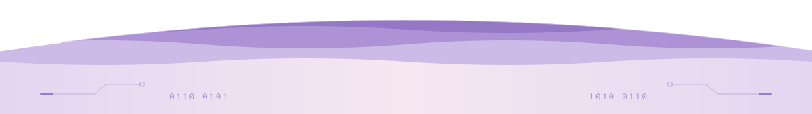

 

<strong>Computer Engineering Student</strong>

 

 

  

<h3>About Me</h3>

Fourth-year Computer Engineering student at <b>Bursa Uludağ University</b>,
interested in <b>AI, NLP, LLMs, RAG, and software engineering</b>.

 

<h3>Currently</h3>

<b>TOFAŞ</b> · Software Engineering Intern
 
Java · Spring Boot · .NET · Angular

<b>TÜBİTAK 2247-C STAR</b> · Undergraduate Research Scholar
 
Turkish NLP · Ankara Dialect Transcription · BilgeBot

<b>Graduation Project</b> · AI Security
 
ML–LLM · Prompt Injection · SOC Decision Support

<b>BUU AI Community</b> · Organizing AI & Technology Events

 

<h3>Tech Stack</h3>

<b>Languages</b>
  

  

<b>AI & NLP</b>
  

  

<b>Frameworks & Tools</b>
  

  

 

  

