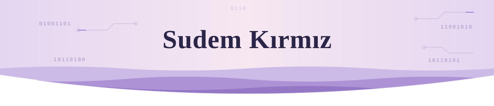

  

**Computer Engineering Student**

 

  
### About Me

Fourth-year Computer Engineering student at **Bursa Uludağ University**, interested in **AI, NLP, LLMs, RAG, and software engineering**.

 

### Currently

**TOFAŞ** · Software Engineering Intern  

**TÜBİTAK 2247-C STAR** · Undergraduate Research Scholar  
Turkish NLP · Ankara Dialect Transcription · BilgeBot

**Graduation Project** · AI Security  
ML–LLM · Prompt Injection · SOC Decision Support

**BUU AI Community** · Organizing AI & technology events
 
### Tech Stack

**Languages**  

**AI & NLP**  

**Frameworks & Tools**  

